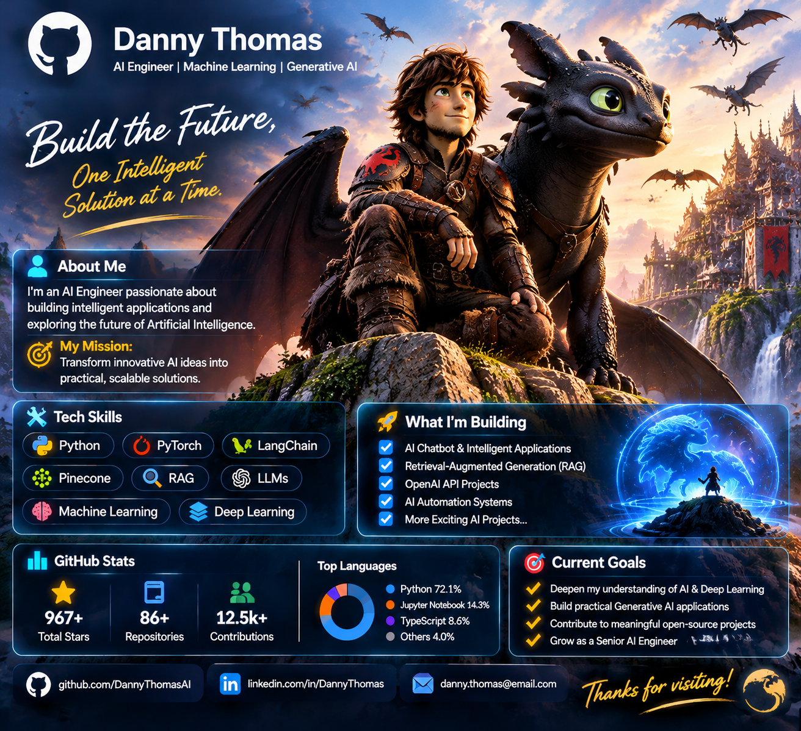

# 👋 Hi, I'm Danny Thomas

### 🚀 AI Engineer | Machine Learning | Generative AI

*Building intelligent solutions for tomorrow's world.*

---

## 👨‍💻 About Me

I'm passionate about Artificial Intelligence and building intelligent applications that solve real-world problems.

- 🤖 Exploring Artificial Intelligence and Generative AI
- 🧠 Learning Machine Learning and Deep Learning
- 💬 Interested in Large Language Models (LLMs)
- 🔍 Exploring Retrieval-Augmented Generation (RAG)
- 🐍 Developing with Python
- 🚀 Building practical AI applications

## 🛠️ Technology Stack

**Programming**
- Python

**AI & Machine Learning**
- PyTorch
- Scikit-learn
- Deep Learning
- LLMs
- LangChain

**AI Infrastructure**
- RAG
- Pinecone
- Vector Databases
- FastAPI

## 🚀 Featured Projects

Coming soon! I'm working on practical AI engineering projects.

- 🤖 AI Chatbot
- 🔍 RAG Knowledge Assistant
- 🧠 Machine Learning Applications
- ⚡ Intelligent Automation

## 🎯 Current Goals

- Master Deep Learning fundamentals
- Build advanced Generative AI applications
- Develop production-ready RAG systems
- Contribute to open-source AI projects

## 📫 Connect With Me

- 💻 GitHub: [My Profile](https://github.com/)

---

### 🐉 Build. Learn. Innovate.

**Thanks for visiting my profile!**

⭐ Feel free to explore my repositories.

  

# 👋 Hi, I'm Danny Thomas

### 🚀 AI Engineer | Machine Learning | Generative AI | LLMs

Building intelligent systems that solve real-world problems.

---

## 👨‍💻 About Me

I'm an AI Engineer passionate about building intelligent applications and exploring the future of Artificial Intelligence.

My interests include:

- 🤖 Artificial Intelligence and Generative AI
- 🧠 Machine Learning and Deep Learning
- 💬 Large Language Models (LLMs)
- 🐍 Python Development
- 🔎 Retrieval-Augmented Generation (RAG)
- ⚡ AI-powered automation and intelligent applications

**My mission:** Transform innovative AI ideas into practical, scalable solutions.

---

## 🛠️ Technical Skills

| Category | Technologies |
|---|---|
| Programming | Python |
| Machine Learning | Machine Learning, Deep Learning |
| Generative AI | Generative AI, LLMs |
| AI Development | AI Chatbots, OpenAI API |
| AI Architecture | RAG, AI Assistants |

---

## 🚀 What I'm Building

I'm continuously developing practical projects to strengthen my AI engineering skills.

- 🐍 Python Programming Projects
- 🤖 Intelligent AI Chatbot
- 🧠 OpenAI API Applications
- 🔍 Retrieval-Augmented Generation (RAG) Assistant
- ⚡ AI Automation Systems

---

## 🎯 Current Goals

- Deepen my understanding of AI and Deep Learning.
- Build practical Generative AI applications.
- Develop advanced LLM-powered solutions.
- Explore modern AI architectures.
- Contribute to meaningful open-source AI projects.

---

## 📊 GitHub Statistics

---

### 💡 "Building the future, one intelligent solution at a time."

**Thanks for visiting my GitHub profile!** ⭐

